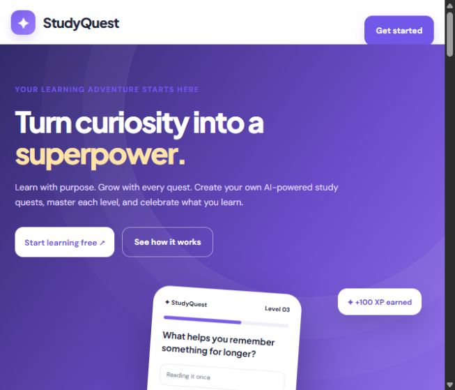

<div align="center">

# ✦ StudyQuest

### Turn curiosity into a superpower.

Create a learning quest from a topic or your own notes, master it one level at a time, and celebrate your progress with shareable certificates.

[**Open the live app →**](https://study-quest-hy-b00d.vercel.app/) · [Source code](https://github.com/sinkorpalace01-cmyk/Study-Quest)



**Built with Django · Powered by Gemma 4 · Designed for every screen**

</div>

---

## The idea

Studying can feel like a long list of material to get through. StudyQuest turns it into a journey: choose what you want to learn, get a structured set of levels and questions, then build momentum as you progress. Learners can bring their own notes, track achievements, and share proof of what they have mastered.

## What you can do

- **Build a learning quest with AI.** Enter a subject, add context, or use source material to generate a multi-level question path. Choose a difficulty and quest length.
- **Learn actively.** Answer multiple-choice questions, see explanations, retry levels, and ask AI to clarify an answer.
- **Make progress visible.** Earn XP, maintain streaks, unlock badges, and compare progress on the leaderboard.
- **Share verified achievements.** Download a polished PDF certificate with the learner's photo, quest level, score, app branding, and a QR verification link. Share it through a link, WhatsApp, LinkedIn, or your device's share sheet.
- **Stay connected.** Manage a profile, receive notifications, and invite other learners.
- **Run the platform.** The owner dashboard manages users and roles, site identity, hero slides, integrations, and contact messages.
- **Use it on mobile or desktop.** Responsive pages, fixed navigation, visible feedback, and a branded animated loader keep the experience clear across screen sizes.

Images and other media can be uploaded from a device or added by URL where supported. The home hero supports multiple image, video, and text slides managed by an administrator.

## AI, thoughtfully applied

StudyQuest sends quest-generation and answer-explanation prompts to **Gemma 4** through the Gemini API. If Gemma is unavailable, quest generation can fall back to **GPT-OSS-20B through Groq**. Generated quest data is checked for the expected levels and answer structure before it is saved.

Provider keys stay on the server. They are configured as environment variables and can be managed through the owner-only integrations area. AI-generated material should be reviewed as part of learning, not treated as a substitute for trusted course material.

## Technology

| Area | Tools |
| --- | --- |
| Web application | Python, Django 5.2, Django templates, HTML, CSS, JavaScript |
| Data | TiDB Cloud (MySQL-compatible), with SQLite for local development |
| AI | Gemma 4 via Gemini API; GPT-OSS-20B via Groq fallback |
| Media | Cloudinary for uploaded images and files |
| Certificates | ReportLab PDF generation and QR-code verification |
| Deployment | Vercel Services |

## Run locally

You need Python 3.12 and pip. The project uses SQLite automatically for local development when TiDB credentials are not set and `DEBUG=1`.

```powershell
python -m venv .venv
.\.venv\Scripts\Activate.ps1
python -m pip install --upgrade pip
pip install -r requirements.txt
Copy-Item .env.example .env
```

Set a local `DJANGO_SECRET_KEY` in `.env` (a development-only value is fine) and keep `DEBUG=1`. Then run:

```powershell
python manage.py migrate
python manage.py createsuperuser
python manage.py runserver
```

Visit [http://localhost:8000](http://localhost:8000). Run the test suite with:

```powershell
python manage.py test
```

AI generation, email, and media upload need their corresponding provider credentials. The rest of the app can be explored locally without configuring those integrations.

## Configure integrations

Copy `.env.example` and fill in only the services you use. Never commit `.env` or paste secrets into client-side code.

| Variable | Purpose |
| --- | --- |
| `DJANGO_SECRET_KEY` | Django signing and encryption key; keep it stable in production. |
| `DEBUG` | Use `1` only for local development; set `0` in production. |
| `SITE_URL` | Canonical public site origin used in email and certificate links. |
| `ALLOWED_HOSTS`, `CSRF_TRUSTED_ORIGINS` | Host and HTTPS origins accepted by Django. |
| `TIDB_HOST`, `TIDB_PORT`, `TIDB_USER`, `TIDB_PASSWORD`, `TIDB_DATABASE` | TiDB Cloud connection. TLS identity and certificate checks are enabled. |
| `GEMINI_API_KEY`, `GEMMA_MODEL` | Primary Gemma 4 integration. |
| `GROQ_API_KEY`, `GROQ_MODEL` | Optional quest-generation fallback. |
| `CLOUDINARY_CLOUD_NAME`, `CLOUDINARY_API_KEY`, `CLOUDINARY_API_SECRET` | Persistent media uploads. |
| `EMAIL_HOST_USER`, `EMAIL_HOST_PASSWORD` | Gmail SMTP delivery for invitations, resets, and notifications. |

## Deploy on Vercel

The project includes a root `vercel.json` with two services: the Django app handles all public paths, and the older browser-only prototype remains internal. In Vercel, import the repository with the project root set to the repository root and select **Services** as the framework. Set the required production environment variables in Vercel's project settings, use a fresh production `DJANGO_SECRET_KEY`, and configure the production database and Cloudinary storage before inviting real users. The public app URL is [study-quest-hy-b00d.vercel.app](https://study-quest-hy-b00d.vercel.app/).

Apply database migrations against the configured production environment before the first live release:

```powershell
vercel link
vercel env run -e production -- python manage.py migrate
```

Vercel's function filesystem is temporary, so user uploads belong in Cloudinary. Set `SITE_URL`, `ALLOWED_HOSTS`, and `CSRF_TRUSTED_ORIGINS` to match the deployed hostname. Make sure the production domain is publicly accessible in Vercel's Deployment Protection settings before sharing the demo link.

## Project layout

```text
accounts/       Email-based accounts, profiles, invitations, and access control
certificates/   PDF certificates, sharing, and public verification
config/         Django settings, URLs, and WSGI entry point
core/           Site identity, landing page, integrations, and contact inbox
notifications/  Learner notifications
quests/         Quest creation, levels, attempts, and AI explanations
static/         Styles, scripts, icons, and bundled images
templates/      Shared layouts and page templates
prototype/      Legacy browser-only demonstration
```

## License

StudyQuest is released under the [MIT License](LICENSE), an OSI-approved open-source license. It permits reuse, modification, and distribution subject to preserving the copyright and license notice. The copyright line credits the project contributors; confirm the project team agrees to this release before publishing the license.

## Security and deployment notes

- Keep `.env`, local databases, uploaded media, and `.local-admin.txt` out of version control; they are ignored by Git.
- Use a dedicated TiDB database for production and a separate database for preview deployments.
- Do not use Vercel's temporary filesystem for user uploads or persistent application data.
- Vercel's Hobby plan is intended for personal, non-commercial use. Review its current terms if the platform will be used commercially.

---

<div align="center">

**StudyQuest — Learn with purpose. Grow with every quest.**

[Live app](https://study-quest-hy-b00d.vercel.app/) · [GitHub](https://github.com/sinkorpalace01-cmyk/Study-Quest)

</div>
